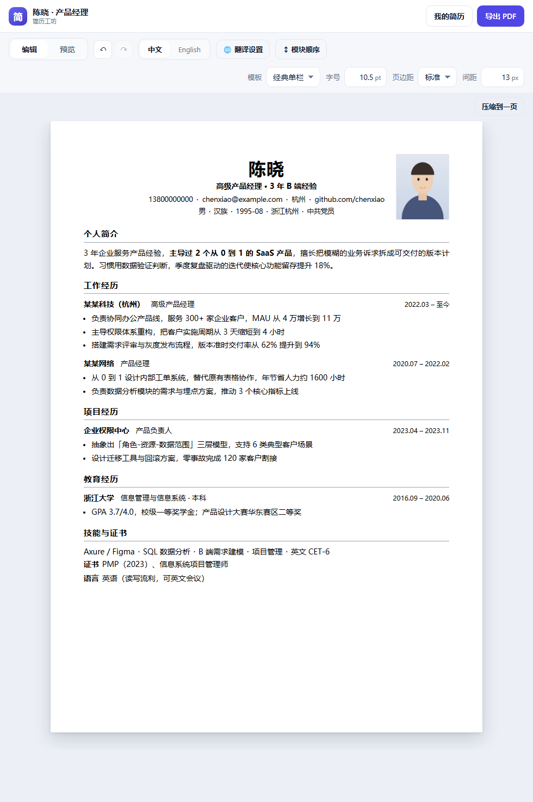
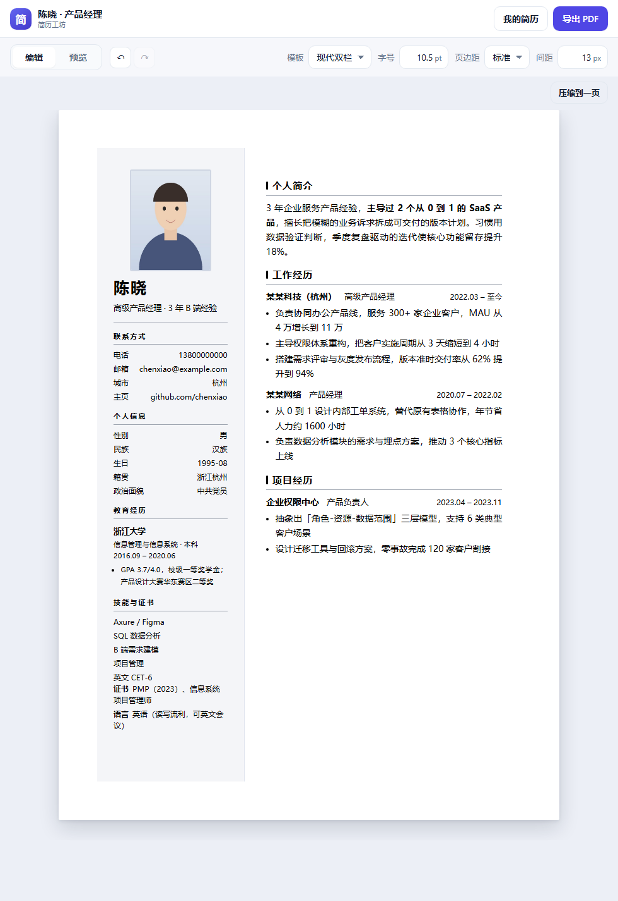
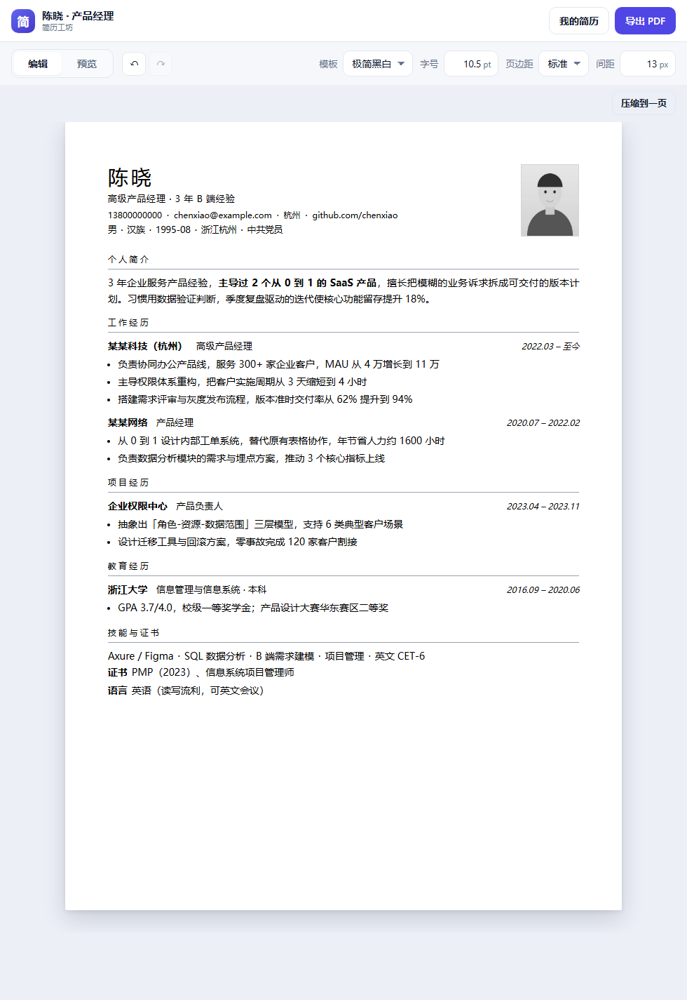
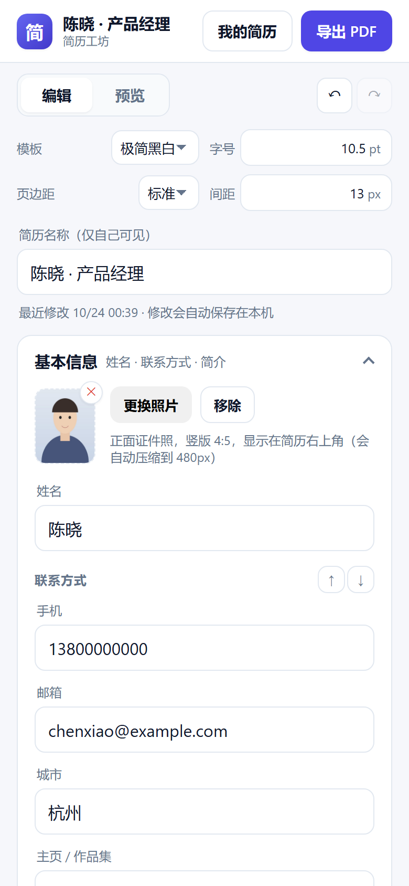
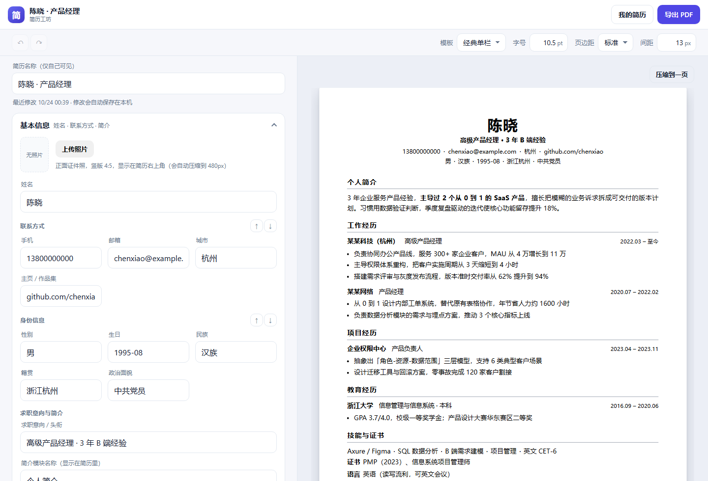

# 简历工坊 · Resume Studio

手机上填写、实时预览、导出 A4 PDF 的简历应用。**纯前端 PWA，零依赖、零构建**，数据只存在本机。

**在线试用**：<https://merely-j.github.io/resume-studio/>


---

## 一、现在就能跑

**最省事：双击 `启动.bat`**，它会启动本地服务器并自动打开浏览器。

手动启动：

```bash
cd resume-app
node server.mjs          # 默认 8080，会打印手机访问地址
```

三种打开方式，按需要选：

| 方式 | 适合 | 说明 |
| --- | --- | --- |
| 双击 `index.html` | 自己电脑上快速改简历 | 不需要服务器，最省事 |
| 双击 `启动.bat` | 要在手机上用、装成 App | 启动本地服务器并自动开浏览器 |
| `node server.mjs` | 开发调试 | 终端里能看到访问日志 |

- 服务器方式：电脑打开 `http://localhost:8080/`，手机连同一个 Wi-Fi 打开终端打印的 `http://192.168.x.x:8080/`
- 手机浏览器菜单里「添加到主屏幕」，就是一个独立 App（PWA，可离线）

### 打包发给别人用

```bash
node tools/build.mjs
```

生成两个版本（同一套代码，只有样式差异）：

| 产物 | 用途 |
| --- | --- |
| `dist/web/` | **网站版**：拖到 Netlify / Vercel / Cloudflare Pages 得到一个网址，别人开链接用；手机可"添加到主屏幕" |
| `dist/简历工坊-手机版.html` | **手机版**：单文件、大按钮、底部固定「看预览 / 导出 PDF」，专门在手机上填简历 |
| `dist/简历工坊.html` | 通用单文件：电脑上双击就用，发谁都能打开 |

手机版的差异只在 `css/mobile.css`（触屏尺寸 + 底部操作条），业务逻辑与网站版完全一致。

部署文档：

- **[DEPLOY-CN.md](DEPLOY-CN.md)** —— **国内方案**（免备案的默认域名 / 自有域名 + 备案，含费用与坑）
- **[DEPLOY.md](DEPLOY.md)** —— 通用分发（Netlify / Vercel / 上架 App）
- **[DOMAIN.md](DOMAIN.md)** —— 海外托管 + 自己域名的 DNS 绑定流程

> **为什么不直接用 ES Module？**
> 早期版本用了 `import/export`。在 `file://` 双击打开、或者被内嵌到「沙箱 iframe」（很多 App 的内置预览就是这样，缺少 `allow-same-origin`）时，浏览器会以同源策略拒绝加载模块脚本——页面只剩顶部栏、下面全空。
> 现在改成普通脚本 + 全局命名空间 `window.RS`，上面三种方式都能跑；代价是不能再用打包工具做 tree-shaking（这个体量完全不需要）。

页面自带**启动自检**：真出问题时会在底部弹出红框，显示具体是哪个文件没加载成功、或者异常堆栈。

### 已经能做的事

| 功能 | 说明 |
| --- | --- |
| 结构化编辑 | 基本信息 / 工作经历 / 项目 / 教育 / 技能 / 证书，可增删、上下移动 |
| 证件照 | 上传自动压到 480px；右上角 ✕ 或「移除」可删，删完可重新上传 |
| 模块改名 | 个人简介/工作经历/项目/教育/技能与证书 都能改名（基本信息固定） |
| 压缩到一页 | 一键同时缩字号、行距、页边距，二分找出刚好塞进一页的最大字号 |
| 可选字段 | 性别/生日/民族/籍贯/政治面貌 + 联系方式，**全部非必选**；留空即从简历里消失 |
| 信息排版 | 生日统一 `1995-08`；身份信息/联系方式可 ↑↓ 调序；姓名居中放大，其余行间距收紧 |
| 富文本 | 个人简介、工作/项目/教育描述支持加粗、斜体、下划线；存的是白名单 HTML（b/i/u/br） |
| 字体字号 | 全文微软雅黑；字号直接填 pt 数字（8–14，默认 10.5），整页同比缩放 |
| 页边距 | 3 档（窄 12mm / 标准 16mm / 宽 20mm），三套模板共用，导出 PDF 同步 |
| 手机号 | 存什么格式都行，展示时统一还原成纯数字（13800000000） |
| 自定义模块 | 内置模块不够用时自建：模块名、5 个字段名（名称/角色/起止时间/内容）都能改，并参与模块排序 |
| 模块排序 | 个人简介/工作经历/项目/教育/技能与证书/自定义模块 可自由上下调序 |
| 模块间距 | 0–40px 可调，控制各模块之间的垂直空隙，导出 PDF 同步 |
| 撤销 / 恢复 | 顶部 ↶ ↷ 按钮或 Ctrl+Z / Ctrl+Shift+Z；连续输入合并成一步，最多 50 步 |
| 纯黑字体 | 三套模板的标题、正文、日期、分隔符统一 `#000`（双栏侧栏因此由深蓝改成浅灰底） |
| 实时预览 | 左边改，右边立刻变，A4 纸 1:1 排版 |
| 三套模板 | 经典单栏、现代双栏、极简黑白，一键切换 |
| 导出 PDF | 走浏览器打印，中文不会乱码，A4 边距精确；默认文件名自动取简历名称 |
| 自动保存 | 输入即存 localStorage，关掉浏览器再打开还在 |
| 多份简历 | 一个岗位一份，可复制、可删除（站内确认框，不依赖浏览器 confirm） |
| 离线可用 | Service Worker 缓存，断网也能打开改 |
| 溢出提示 | 内容超过一页会提示「约 N 页 A4，导出自动分页」 |

### 截图

| 经典单栏（带照片） | 现代双栏 | 极简黑白 |
| --- | --- | --- |
|  |  |  |

| 手机端编辑 | 桌面分栏 |
| --- | --- |
|  |  |

---

## 二、为什么这样选（决策记录）

你最初的三个选择，对应三个关键取舍：

**1）PWA，而不是 Flutter / React Native / 原生**

| | PWA（本项目） | Flutter / RN | 原生 |
| --- | --- | --- | --- |
| 上手成本 | 会 HTML/JS 就行 | 要装环境、学 Dart | 要两套代码 |
| 上架 | 可先不通过商店，链接就能用 | 要打包签名 | 要打包签名 |
| 体验 | 略逊于原生 | 接近原生 | 最好 |
| 适合 | 验证需求、快速上线 | 长期做产品 | 深度系统集成 |

简历这种「填表 + 看排版 + 导出」的工具，PWA 足够；而且**先有链接能发给朋友试用**，比先上架重要得多。

**2）结构化表单，而不是解析已有的 PDF/Word**

解析排版（尤其是中文 PDF 的字体、表格、分栏）是这类产品里最贵的部分，且很难做到「改一个字不破坏原版式」。先用表单把数据拿结构化，排版由我们控制，效果稳定、可继承模板。等用户量起来再做「导入 PDF → 智能提取字段」，那是第二阶段。

**3）不用框架、不用构建工具、也不用 ES Module**

没有 React/Vue/Webpack。原因是这份代码要给你看懂、改动：
- 改样式只改 CSS，不用重新编译
- 打开开发者工具就能断点调试源码
- 以后想换框架，`preview.js` 那层纯函数可以整段搬走

不用 `import/export` 是踩坑后的选择：模块脚本在 `file://` 和沙箱 iframe 里会被同源策略拒绝（见上文）。代价只是失去打包工具的 tree-shaking，这个体量无所谓。

---

## 三、代码结构

```
resume-app/
├── index.html            页面骨架 + 启动自检（脚本加载失败会显示原因）
├── 启动.bat              双击启动服务器并打开浏览器（Windows）
├── manifest.webmanifest  PWA 清单：名称、图标、独立窗口
├── sw.js                 Service Worker：离线缓存
├── server.mjs            本地静态服务器（带访问日志）
├── DEPLOY-CN.md          国内部署（免备案 / 备案两条路）
├── DEPLOY.md             通用分发（Netlify / Vercel / 上架 App）
├── DOMAIN.md             海外托管 + 自定义域名与 DNS
├── css/
│   ├── app.css           手机界面：布局、表单、按钮、深色模式
│   ├── resume.css        A4 纸张、三套模板、打印样式
│   └── mobile.css        手机版专用（大按钮 + 底部操作条，只打进手机版）
├── js/                   全部是普通脚本，按顺序加载，挂到 window.RS
│   ├── model.js          数据模型 + 示例简历 + 工具函数
│   ├── store.js          localStorage 读写、JSON 导入导出
│   ├── preview.js        数据 → 简历 HTML（纯函数，不碰 DOM）
│   ├── editor.js         数据 → 表单 HTML + 事件委托
│   └── app.js            主控：状态、视图切换、增删、打印
├── tools/
│   ├── build.mjs         打包：网站版 / 通用单文件 / 手机版
│   ├── set-icp.mjs       把备案号写进页脚（打印时隐藏）
│   ├── make-icons.py     生成 PWA 图标
│   ├── templates.html    单模板 1:1 预览（设计校对用）
│   ├── measure.html      布局测量（排查手机宽度问题）
│   ├── sandbox-test.html 模拟"沙箱 iframe"环境（复现白屏用）
│   ├── check-boot.mjs    验证启动自检能不能兜住脚本加载失败
│   ├── dump-console.mjs  抓 iframe 里的异常和 404
│   └── shot-templates.mjs 生成 README 里的模板截图
└── tests/
    ├── smoke.mjs         纯函数测试：渲染、转义、导入导出
    └── e2e.mjs           真浏览器测试：打字、增删、刷新恢复
```

---

## 四、关键实现（一步一步）

### 第 1 步：先定数据，再定界面

一份简历就是一个普通 JS 对象：

```js
{
  id: 'i...', title: '陈晓 · 产品经理', template: 'classic',
  basics: { name, headline, phone, email, city, link, summary, photo,
            gender, birthday, ethnicity, hometown, politics,   // 后五个都可选
            blockOrder: ['contact', 'personal'] },             // 两块谁在上
  fontSize: 10.5,                                           // pt，8–14
  pageMargin: 16,                                           // 毫米：12 / 16 / 20
  sectionGap: 13,                                           // 模块间距 px，0–40
  fitOnePage: false,                                        // 压缩到一页
  sectionTitles: { experience: '职业经历' },                 // 模块改名（可空）
  sectionOrder: ['summary', 'experience', 'projects', 'education', 'skills'],
  customSections: [{ id, title, labels: { name, role, start, end, desc }, items: [] }],
  experience: [{ id, company, role, start, end, desc }],
  projects:   [{ id, name, role, start, end, desc }],
  education:  [{ id, school, degree, start, end, desc }],
  skills: ['Figma', 'SQL'],
  extras:     [{ id, label, value }]
}
```

两个细节值得注意：

- **每条记录带 `id`**。如果表单按数组下标更新，删掉第 2 条后，第 3 条会「继承」它的值。
- **时间用自由文本**（`2021.07` / `至今`），不用日期控件。中文简历里这两种写法太常见，日期选择器反而更难用。

### 第 2 步：把「数据 → 页面」写成纯函数

`preview.js` 只做字符串拼接，不查 DOM：

```js
export function renderResume(resume) {
  const render = RENDERERS[resume.template] || RENDERERS.classic;
  return render(resume);
}
```

好处：能在 Node 里直接跑测试；预览和打印共用同一份 HTML；以后做「服务端渲染 PDF / 分享页」可以直接复用。

所有用户输入都过 `esc()` 转义——简历里填 `` 也不会变成代码。

### 第 3 步：表单用事件委托，打字时不重绘

这是手写表单最容易踩的坑：每输入一个字符就 `innerHTML = ...` 重建表单，输入框会立刻失焦。

本项目的做法：

```js
// editor.js：只绑定一次，靠 data-* 分发
root.addEventListener('input', (event) => {
  if (el.matches('[data-bind]'))        handlers.setPath(el.dataset.bind, el.value);
  else if (el.matches('[data-field]'))  handlers.setField(el.dataset.section, el.dataset.id, el.dataset.field, el.value);
});
```

- **打字** → 只改数据 + 重绘右侧预览（`requestAnimationFrame` 合并），表单不动 → 焦点不丢
- **增删条目 / 换简历** → 整体重绘表单，并自动聚焦到新条目

### 第 4 步：A4 用毫米，屏幕用缩放

纸的尺寸写死 `210mm × 297mm`，屏幕放不下就 `transform: scale()`：

```css
.paper { width: 210mm; min-height: 297mm; flex: none; }
```

**`flex: none` 是必须的。** 纸张在 flex 容器里默认会被压缩到容器宽度（手机上就变 358px），文字换行爆掉，内容凭空多出一页——这个 bug 我在开发时就踩到了，`tools/measure.html` 就是为它写的。

**照片怎么放？** 照片用 `position: absolute` 贴右上角，同时给文字容器左右各加 30mm 内边距——姓名视觉上仍然居中，但不会压到照片。因为整张纸用的是毫米单位，手机上缩放后照片位置也不会错。

**存之前必须先压缩。** 手机原图 3–5MB，转成 base64 更大，而 localStorage 通常只有 5MB 配额，存原图必然写失败。上传时用 canvas 把长边压到 480×600、转 JPEG（质量 0.86），一张约 20KB，也能塞进 JSON 备份里。

### 第 5 步：导出 PDF = 打印样式

没有引 jsPDF / html2canvas。中文用它们要么字体几百 KB，要么截图糊。直接用浏览器打印：

```css
@media print {
  @page { size: A4; margin: 0; }   /* 边距交给 .paper 自己的 padding */
  .app-header, .editor-pane, .toast { display: none !important; }
  .paper { transform: none !important; box-shadow: none !important; }
}
```

页面上「导出 PDF」→ `window.print()` → 用户在打印对话框选「另存为 PDF」。iOS 上是「分享 → 打印 → 存储为 PDF」。

**为什么不能直接下载 PDF？** 浏览器不允许网页静默生成 PDF 文件；能"直接下载"的方案（html2canvas + jsPDF）会把文字栅格化成图片，中文变糊、文件变大，和我们要的精确排版相反。折中做法：打印前把 `document.title` 临时换成简历名称——Chrome/Edge 的「另存为 PDF」默认文件名就取页面标题，用户只需点保存。

同一套 CSS 保证「预览看到的 = 导出的」，不会两边不一致。

### 第 6 步：持久化与防抖

```js
setTimeout(() => saveState(state), 250);  // 停手 250ms 才写一次
```

存整个 `{ version, resumes, activeId }`。`store.js` 里的 `normalize()` 会给旧数据补字段——以后加字段、改结构，老用户的简历不会崩。

想换后端时，只需要改 `store.js` 这一个文件（把 `localStorage.setItem` 换成 `fetch('/api/resumes')`）。

### 第 7 步：变成「能装到手机」的 App

- `manifest.webmanifest`：名称、图标、`display: standalone`（隐藏地址栏）
- `sw.js`：页面导航 network-first，静态资源 cache-first，断网回退缓存
- 图标用 `tools/make-icons.py` 生成，改配色重跑一次即可（含 Android maskable 版本）

### 第 8 步：测试

```bash
node tests/smoke.mjs      # 纯函数：三套模板、XSS 转义、空数据、JSON 往返、防模块语法回归 —— 10 个用例
node tests/e2e.mjs        # 真浏览器：打字、加经历、加技能、换模板、刷新恢复 —— 11 个用例
```

`smoke.mjs` 用 Node 的 `vm` 造一个最小 `window` 环境来加载普通脚本，所以不需要浏览器。

`e2e.mjs` 通过 Chrome 调试协议（CDP）操作页面，不需要装 Puppeteer。跑之前先：

```bash
chrome --headless=new --remote-debugging-port=9333 http://127.0.0.1:8080/
```

---

## 五、下一步路线

**P0 打磨体验（1–2 周）**
1. 分页预览：现在是一整条长纸，改成真的分页显示（`Paged.js` 或手动按 A4 高度切块）
2. 撤销/重做：每次修改压栈，手机上误删能救回来
3. 更多模板 + 字号/行距/主色调节
4. 头像上传、二维码（微信/电话）
5. 手机上看不清预览 → 加「适应宽度 / 100%」切换

**P1 产品化（1–2 个月）**
6. 账号 + 云端同步（Supabase / 自建 Node API），换设备不用导 JSON
7. 分享链接：生成只读网页版简历，HR 点开就能看
8. 导入：上传 PDF/Word 提取字段（先用 `pdf.js` + 正则，再考虑 LLM）
9. AI 润色：把「负责运营」改成「主导 3 人团队，季度 GMV 提升 40%」——接 LLM API
10. JD 匹配：粘贴岗位描述，提示简历缺哪些关键词

**P2 上架（3 个月+）**
11. 打包：PWABuilder 或 Capacitor 包成 iOS/Android 安装包
12. 隐私政策 + 用户协议（简历含个人信息，必须有）
13. 中国区上架：App 备案、软著、应用商店资质
14. 商业化：免费 1 份 + 付费解锁模板/AI 次数

**不建议现在做的**：用户体系、支付、社区。先用 PWA 发链接给 10 个真实求职者用，看他们卡在哪一步——大概率是「不知道怎么写工作内容」，那才是产品的真需求。

---

## 六、常见问题

**页面空白，只有顶部栏？**
底部应该有一个红框。它一般会说清楚原因，常见三种：
1. **`file://` 双击打开** → 旧版本会这样，现在已支持，刷新即可
2. **在沙箱 iframe 里打开**（App 内置预览常见）→ 旧版本会这样，现在已支持
3. **缓存了旧版本** → 点红框里的「清除缓存并重新加载」

如果红框里是「应用没有启动 / 脚本加载失败」，说明某个 js 文件没取到，按 F12 看 Network 里哪个 404。

**手机上打开一片空白？**
1. 确认手机和电脑在同一个 Wi-Fi，用的是电脑的局域网 IP（不是 `localhost`）
2. Windows 防火墙可能拦了 8080 端口：首次运行 node 时若弹出提示要选「允许访问」；若当时点了取消，需要到「Windows 安全中心 → 防火墙 → 允许应用通过防火墙」里给 Node.js 放行，或者把网络配置文件从「公用」改成「专用」

**在沙箱/内嵌窗口里，改了会保存吗？**
不会。这类环境禁止访问 localStorage，应用会降级为「只在当前页面有效」，底部会提示保存失败。要持久保存请用 `启动.bat` 在正常标签页里打开。

**导出的 PDF 里会不会带上界面元素？**
不会。打印样式只保留纸张本身：顶部栏、工具栏、「压缩到一页」按钮、编辑器全部隐藏（`css/resume.css` 的 `@media print` 段）。e2e 里有一条用例专门守这个：模拟打印媒体后断言这些元素的 `display` 为 `none`。

**导出的 PDF 没有深色侧栏？**
打印对话框里勾选「背景图形 / Background graphics」。双栏模板的深色来自背景色。

**数据会丢吗？**
存在浏览器 localStorage：清缓存、换浏览器会丢。重要简历建议导出 PDF 留档（JSON 备份功能已按反馈移除）。

**能改成我公司的模板吗？**
改 `css/resume.css` 加一段 `.tpl-你的名字`，再在 `js/preview.js` 加一个模板函数、`js/model.js` 的 `TEMPLATES` 里注册即可。字段不用动。

---

## 七、发布到 GitHub

仓库里已经准备好 `.gitignore`、`.gitattributes`、`LICENSE` 和一个 **GitHub Pages 自动部署**工作流（`.github/workflows/pages.yml`）。

### 1. 建仓库并推送

```bash
cd resume-app

git config --global user.name "你的名字"      # 只需设置一次
git config --global user.email "你的邮箱"

git commit -m "初始化：简历工坊"
git branch -M main
git remote add origin https://github.com/<你的用户名>/<仓库名>.git
git push -u origin main
```

在 <https://github.com/new> 建仓库时注意：

- **仓库名用英文**（`resume-studio`、`resume-app`），中文名会让链接变成 `%E7%AE%80...`
- **不要勾选** "Add a README / .gitignore / license"，本地已经有了，勾了会冲突
- 想用 GitHub Pages：**仓库必须是 Public**（私有仓库用 Pages 需要付费账号）

推送时会要求登录。Git for Windows 自带的凭据管理器会弹出浏览器登录，按提示授权即可（密码方式已不支持，走的是 OAuth/Token）。

### 2. 开启 GitHub Pages（可选，免费）

1. 仓库 → **Settings → Pages**
2. Source 选 **GitHub Actions**
3. 推送到 `main` 后自动构建，几十秒后得到 `https://<用户名>.github.io/<仓库名>/`

工作流会先跑 `node tools/build.mjs` 再发布 `dist/web`，所以你只要 push，线上自动更新。

> 国内访问 `github.io` 一般，比 Netlify 稳定但不算快；要给国内用户长期用，还是走 [DEPLOY-CN.md](DEPLOY-CN.md)。

### 3. 仓库信息建议

- **Description**：`手机上填写、排版并导出 A4 PDF 的简历工具，纯前端零依赖`
- **Topics**：`resume` `resume-builder` `pwa` `vanilla-js` `pdf` `mobile-first` `chinese`
- 在 README 顶部加一行链接到线上地址，访客能直接试

### 4. 许可证

本项目采用 **MIT**（见 [LICENSE](LICENSE)），别人可以自由使用、修改、商用，只需保留版权声明。

如果你不希望被商用，把 `LICENSE` 换成 [CC BY-NC 4.0](https://creativecommons.org/licenses/by-nc/4.0/) 之类的协议，或在 README 里写明「仅供学习交流」——但注意：**没有许可证的公开仓库，别人在法律上不能使用你的代码**。

