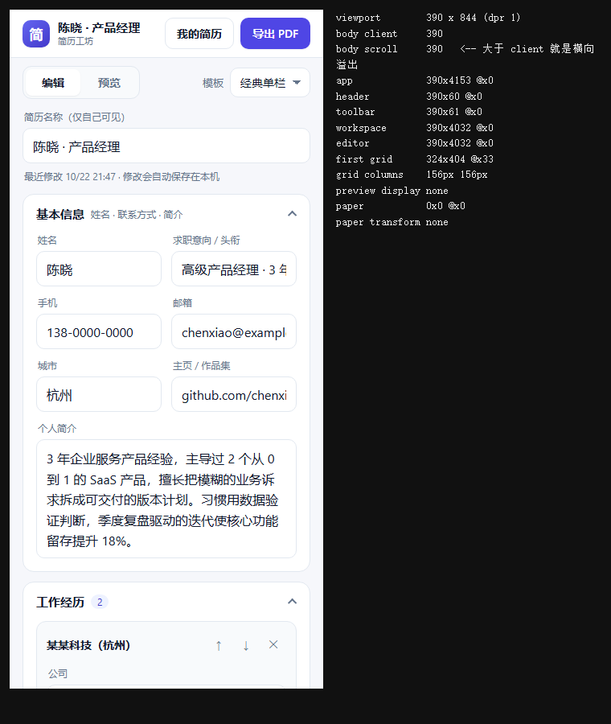
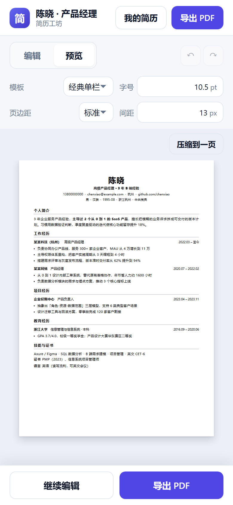

# 简历工坊 · Resume Studio

在手机上填一份结构化简历，实时看到 A4 排版，一键导出 PDF。**纯前端，零依赖，数据只留在你自己的设备上。**

**在线直接用**：<https://merely-j.github.io/resume-studio/>

简体中文 · [English](README.en.md)



---

## 能做什么

**填写**

- 结构化录入：基本信息、工作经历、项目、教育、技能与证书
- 每条经历可增删、上下移动；**模块可改名、可调顺序、可调间距**
- 内置模块不够用？可加「自定义模块」，模块名和 5 个字段名都能改成你要的（比如"获奖经历 / 奖项 / 颁发机构 / 时间 / 时间 / 说明"）
- 所有字段都是可选的：留空就不出现在简历里，不留空行、不留多余分隔符
- 段落支持**加粗 / 斜体 / 下划线**
- 手机号随便填（`138-0000-0000`、`138 0000 0000`），展示时统一成纯数字
- 证件照上传，自动压缩到 480px，可随时删除或更换

**排版**

- 实时 A4 预览，三套模板：经典单栏、现代双栏、极简黑白
- 字号按 pt 数字调（8–14）、页边距三档、模块间距 0–40px
- **一键压缩到一页**：同时缩字号、行距、页边距，二分找刚好塞进一页的最大字号
- 全文微软雅黑，标题、正文、日期统一纯黑

**输出**

- 导出 PDF：A4 精确、中文不乱码、不含任何界面元素，文件名默认就是简历名称
- 数据自动保存在本机，关掉浏览器再打开还在
- 多份简历管理：一个岗位一份，可复制、可删除
- 撤销 / 恢复（Ctrl+Z / Ctrl+Shift+Z），最多 50 步
- 可"添加到主屏幕"当 App 用，断网也能打开

---

## 适合谁用

| 谁 | 为什么合适 |
| --- | --- |
| **正在找工作的人** | 一个岗位一份简历，换模板、改两句话，30 秒出一个版本 |
| **需要中文排版的求职者** | 中文字体、证件照、一页限制——这些国内简历的刚需都做了 |
| **不想把简历传到云上的人** | 数据只存本机浏览器，没有账号、没有服务器 |
| **经常改简历的人** | 多版本 + 撤销，误删能救回来，不用从头再写 |
| **帮别人改简历的** | 发一个 HTML 文件给对方，双击就能用，不用装东西 |
| **HR / 学长学姐 / 朋友** | 拿单文件帮人当场改，改完直接导出 PDF |

**不适合**：

- 需要**多人协作 / 跨设备同步**——目前没有账号体系，数据不跨设备
- 需要**导入已有 PDF/Word 自动解析**——还没做，现在是从零填写
- 需要**在线投递 / 招聘方后台**——只做简历本身

---

## 怎么用

### 1. 在线用（最快）

打开 <https://merely-j.github.io/resume-studio/>，填完点右上角「导出 PDF」，在打印窗口选「另存为 PDF」。

### 2. 手机上用

- 打开上面的网址 → 浏览器菜单 → **添加到主屏幕**，之后像 App 一样打开
- 或者用**手机版单文件**（大按钮 + 底部「看预览 / 导出 PDF」操作条）：把 `dist/简历工坊-手机版.html` 发到手机，用浏览器打开



### 3. 本地用（不联网）

- **Windows 最省事**：双击 `启动.bat`，自动起服务并打开浏览器
- 或者双击 `index.html`（单文件也能直接跑）
- 开发者：`node server.mjs` → `http://localhost:8080/`

手机想用本地版：电脑和手机连同一个 Wi-Fi，手机打开终端打印的 `http://192.168.x.x:8080/`。

### 4. 打包分发

```bash
node tools/build.mjs
```

| 产物 | 用途 |
| --- | --- |
| `dist/web/` | 网站版，部署到任意静态托管 |
| `dist/简历工坊.html` | 通用单文件，发谁都能双击打开 |
| `dist/简历工坊-手机版.html` | 手机版，触屏更顺手 |

---

## 怎么做（技术概览）

**纯静态**：HTML + CSS + 原生 JS，没有框架、没有打包工具、没有 npm 依赖。改完刷新就生效。

**为什么不用 ES Module**：模块脚本在 `file://` 双击、以及被嵌进沙箱 iframe 时会被同源策略拒绝加载，页面直接空白。改成普通脚本 + `window.RS` 命名空间后，这三种环境都能跑。

**A4 与打印**：纸张固定毫米尺寸，屏幕用 `transform` 缩放；打印时用 `@media print` 隐藏全部界面，预览和 PDF 共用一套 CSS。

```
js/model.js     数据模型与格式化
js/store.js     localStorage 读写、旧数据兼容
js/preview.js   数据 → 简历 HTML（纯函数）
js/editor.js    数据 → 表单 + 事件委托
js/app.js       主控：状态、撤销、打印
css/resume.css  A4 纸张、三套模板、打印样式
```

开发命令：

```bash
node server.mjs          # 本地服务器（带访问日志）
node tools/build.mjs     # 打包三种产物
node tests/smoke.mjs     # 纯函数测试
node tests/e2e.mjs       # 真浏览器端到端测试
```

更细的取舍、数据流、实现坑点见 **[ARCHITECTURE.md](ARCHITECTURE.md)**。

---

## 部署

- **[DEPLOY-CN.md](DEPLOY-CN.md)** —— 国内方案（免备案的平台域名 / 自有域名 + 备案）
- **[DEPLOY.md](DEPLOY.md)** —— 通用分发（Netlify / Vercel / GitHub Pages / 上架 App）
- **[DOMAIN.md](DOMAIN.md)** —— 自己域名的 DNS 绑定流程

GitHub Pages 已配好自动部署：push 到 `main` 后，`.github/workflows/pages.yml` 会自动构建并发布。

---

## 常见问题

**手机打不开 / 显示空白？**
用 `http://` 或 `https://` 打开，不要用 `file://`。局域网访问要连同一个 Wi-Fi，并放行防火墙。

**数据会丢吗？**
存在浏览器 localStorage：清缓存、换浏览器会丢。重要简历记得导出 PDF 留档。

**导出的 PDF 有背景色缺失？**
打印对话框里勾选「背景图形 / Background graphics」。

**能改成我们公司的模板吗？**
可以。改 `css/resume.css` 加一段模板样式，再在 `js/preview.js` 加对应函数即可，字段不用动。

---

## 许可证

[MIT](LICENSE) —— 可以自由使用、修改、商用，保留版权声明即可。
